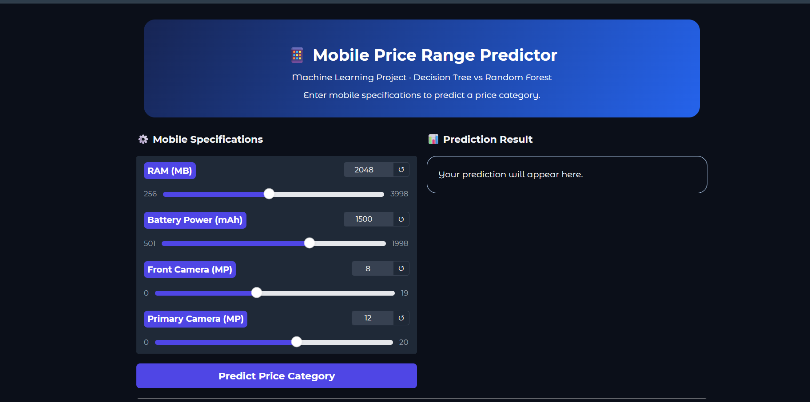
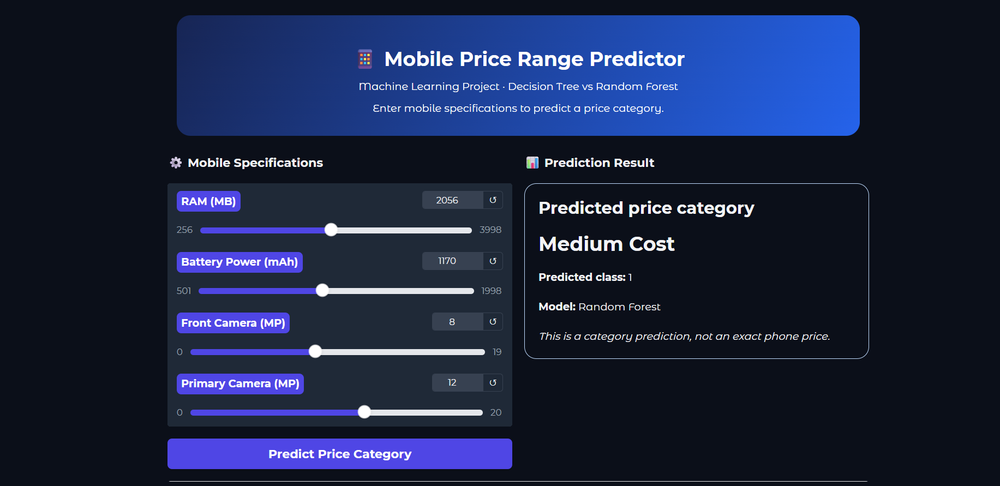

Mobile Price Prediction

A Machine Learning web application that predicts the mobile phone price category based on selected phone specifications.

Live Demo

"Click here to try the Mobile Price Prediction app" ( https://mobile-price-prediction-3-kkbm.onrender.com)

About the Project

This project uses a trained Machine Learning classification model to predict one of four mobile phone price categories:

- Low
- Medium
- High
- Very High

The application takes four input features and provides an estimated price category. The predictions are estimates and may not reflect actual market prices.

Technologies Used

- Python
- Gradio
- Scikit-learn
- Pandas
- Joblib

Features

- Interactive web interface
- Machine Learning-based price category prediction
- Four mobile price categories
- Online deployment using Render

Project Files

- "app.py" — Application code
- "requirements.txt" — Python dependencies
- "mobile_price_model.joblib" — Trained model and related information

How to Run Locally

1. Clone the repository:
   
   git clone YOUR_GITHUB_REPOSITORY_URL

2. Open the project folder:
   
   cd mobile-price-prediction

3. Install the dependencies:
   
   pip install -r requirements.txt

4. Start the application:
   
   python app.py

5. Open the local URL shown in your terminal.

Screenshots

### Application Interface

### Example Prediction

Disclaimer

The predicted category is an estimate generated by a trained Machine Learning model. It is not a guaranteed market price.

Author

Created as a Machine Learning project to practice model deployment and interactive web application development.
